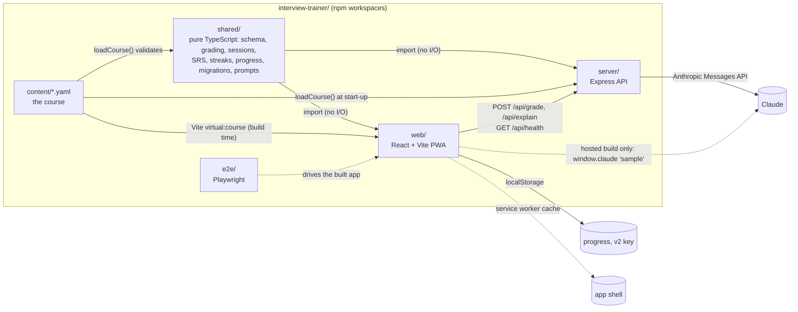
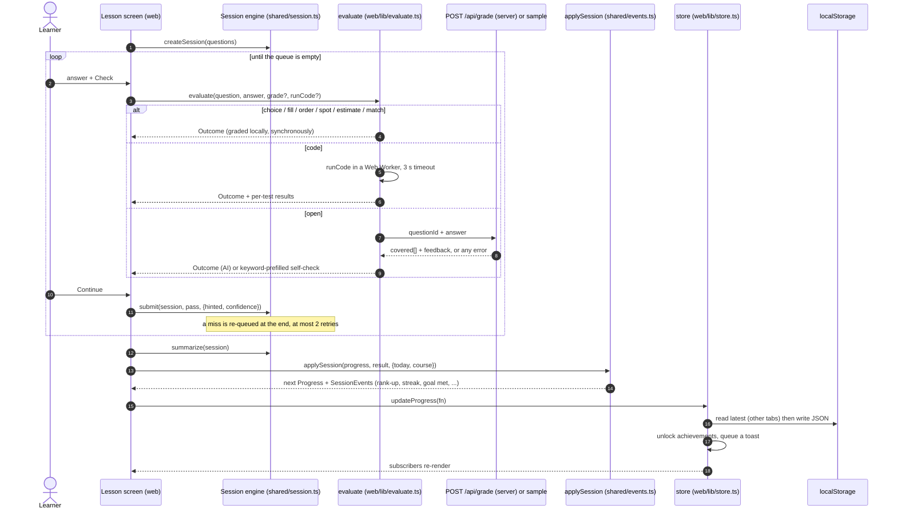

# Architecture

How the Interview Trainer is put together, why, and where the seams are. Read this before changing anything that crosses a package boundary.
For habit-loop design and its ethics rules see [engagement.md](engagement.md); for accessibility see [accessibility.md](accessibility.md); for the
day-to-day workflow see [contributing.md](contributing.md) and [testing.md](testing.md).

## Components

| Package | Owns | Must not |
|---|---|---|
| `content/` | The course as YAML, one file per unit, plus the tests that keep it honest. | Contain code or configuration. It is the most portable asset. |
| `shared/` | Everything that can be decided without a browser or a network: zod schema and cross-field validation (`schema.ts`), grading of the eight deterministic question types (`grade.ts`), the lesson session engine (`session.ts`), spaced repetition (`srs.ts`), streaks/goals/ranks/mastery/achievements, the `Progress` model with its migrations and merge (`progress.ts`, `migrate.ts`, `backup.ts`, `storage.ts`), prompt builders (`grading-prompt.ts`, `explain.ts`), the code-test harness (`code-runner.ts`). | Touch `window`, `localStorage`, `fetch`, `Date.now()` or `Math.random()`. Time and storage are passed in. Only `load-content.ts` (exported as `@trainer/shared/node`) reads files. |
| `server/` | `createApp()` (Express routes, validation, rate limiting, static serving), `AnthropicGrader`, `AnthropicTutor`, and the entry point `main.ts`. | Hold state. It is stateless: every request is answered from the course and the request body. |
| `web/` | Screens and components (`src/screens`, `src/components`), plus `src/lib` for the glue that does touch the platform: the progress `store`, `evaluate`, API clients, the Web Worker wrapper, notifications, canvas drawing. | Re-implement rules. If it is a rule, it lives in `shared/` and has a unit test. |
| `e2e/` | Playwright specs that play the real, built UI at phone size. | Depend on AI being available. |

Dependency direction is strict: `web` and `server` import `shared`; `shared` imports nothing from them; `content` is data.
`web/src/lib` is the only place in `web/` with unit tests, because the components are deliberately thin (see [testing.md](testing.md)).

## Data flow of one lesson

Points worth knowing:

- **Everything except the two outbound calls (the model and the worker) is pure or injected.** `applySession` takes `today` and the course as arguments and returns a new `Progress` plus a list of `SessionEvent`s; the UI only decides how to celebrate them. That is why streaks, freezes, DST and "the clock moved backwards" can be tested without a browser.
- **`updateProgress(fn)` always re-reads storage first**, so a write from another tab is applied *under* this tab's change instead of being overwritten. Between ticks the `storage` event keeps tabs in sync.
- **Writes are best effort, and never silent.** A quota error or a storage area that throws leaves the in-memory profile intact and marks it `dirty`. `lastRaw` keeps meaning "what storage really holds", so the next `updateProgress` does not mistake our own unsaved state for stale data and replace it with the older stored copy (that bug used to drop every session played while storage was full). The store retries with backoff (4 s doubling to 60 s), when the page is hidden or closed, and when the browser comes back online; if another tab wrote in the meantime the unsaved changes are *merged* on top of it. If `localStorage` itself is unavailable (private window, sandboxed frame) the store falls back to a per-tab in-memory map. Either way `useSafetyStatus()` reports it (`persistence: 'ok' | 'memory' | 'failing'`, `atRisk`) and `DataSafetyBanners` shows a non-blocking notice with *Download backup*, *Copy backup text* and, where downloads and the clipboard are blocked too, the text to select by hand. `atRisk` stays false until the learner has something to lose, so browsing a blocked host is not nagged about.
- **A foreign value in the main key never replaces an open tab's profile.** When another page of the same origin writes something this tab cannot read (a newer schema, truncated JSON) or the key disappears (cleared, evicted), `syncFromStorage` keeps the in-memory profile if it holds anything (XP, sessions or cards; an empty tab just adopts what is there). The foreign value is parked (`parkRaw`, kind `unreadable`, so the *Recovered data* banner announces it), and the profile is written back only after that copy exists (`saveProgress` refuses to write otherwise and the tab retries). A corrupt or emptied key is repaired at once, because this tab may hold the only good copy; a newer-schema value belongs to a newer tab that holds its own state, so it stays in place until this tab next changes something. Two tabs that both see the same foreign value park it once (identical copies are reused) and then agree through the normal readable-value sync.
- **An unfinished session is saved apart from `Progress`.** After every question that was answered and continued from, `LessonScreen` writes the session (the ids of the questions still to ask, each with the hash of what it asks, plus XP, attempts, misses, hints and ratings) to its own key, `interview-trainer.resume.v1`, through `web/src/lib/resume.ts`. It is scratch state about one session, so it is not exported, merged or migrated, and a failed read or write only means the session starts again: no banners. `readResume` (`shared/src/resume.ts`) rebuilds the session against the *current* course and drops the record unless it is well formed, under 48 hours old, and every question still exists and still asks the same thing (a moved or reworded question must never resume into the wrong place). One session is kept at a time. Opening the same route (`#/lesson/<id>`, `#/daily`, `#/mix`, `#/review`, `#/warmup`, `#/topic/<id>`) carries on from it, with the saved questions rather than a new pick; Home shows a Resume card with a Discard. Finishing clears it, and so do resetting or replacing the profile. XP, cards and the day log are still settled only by `applySession` when the session finishes, so nothing is double counted. Leaving (the X or the browser's Back) therefore needs no confirmation: the only thing dropped is the question on screen.
- **A finished session settles three things at once**: lessons/XP/missed (the v1-visible part), the spaced-repetition cards (`applyToCards`), and the day log, streak and milestones. The single write path is `applySession`; nothing else mutates learning data.
- **Open questions with follow-ups** are two gradings: the main answer, then an authored follow-up chosen by what the learner covered (`pickFollowUp`). The question passes on the mean of both scores.

## The `Progress` model and its migrations

`Progress` (`shared/src/progress.ts`) is one JSON document under the key `interview-trainer.progress.v2`. The README has the field-by-field tour; the rules below are the ones you must keep when changing it.

**Load order** (`shared/src/storage.ts`, `loadProgress`): v2 key, normalised and written back if anything changed; otherwise migrate the v1 key (`interview-trainer.progress.v1`) and write v2; otherwise empty. The v1 key is never deleted, so rolling back to an older build keeps working.

**Everything stored is untrusted.** `migrateProgress(raw, ctx)` accepts any value (object, JSON string, garbage, `null`) and never throws:

| Input | Result |
|---|---|
| `null` / `undefined` | empty progress, `from: 0` |
| not JSON, not an object | `problem: 'corrupt'`, empty progress |
| `version: 1` | lossless upgrade (`fromV1`): v1 fields kept, cards seeded for completed lessons, one welcome freeze, ranks already earned are pre-marked so they do not celebrate again |
| `version: 2` | `normalizeProgress` clamps and repairs every field, then `pruneProgress` drops cards whose question hash no longer matches and days older than 400. When normalising throws away something that was stored (`lossy: true`: a field this version does not know, a malformed value such as `streak: "x"`, an invalid record) the original text is parked first, and not rewritten if no copy can be made; defaults being filled in, clamped numbers and routine ageing of old days are not lossy |
| `version > 2` | `problem: 'future-version'` |

When `problem` is set, the caller **must not overwrite** the stored value until a copy of it exists. `saveProgress` enforces this with the `protectedRaw` it is given: it parks the value first (`parkRaw`), and if that copy cannot be written (quota, blocked storage) it writes **nothing** and returns `skipped: true`, so the unreadable value stays where it is, still the only copy. The store keeps `protectedRaw` (and the learner's new progress in memory, with a visible "not saved" notice) until a copy succeeds.

**Parked copies** (`shared/src/storage.ts`): copies are never replaced and rotate.

| Key | Holds | Kept |
|---|---|---|
| `interview-trainer.progress.backup-YYYYMMDD[-NN]` | unreadable data (corrupt, or written by a newer version) set aside before it would be overwritten | the newest 8 |
| `interview-trainer.progress.before-YYYYMMDD-NN` | a readable profile as it was just before *Replace my progress*, *Restore (replace)* or *Reset progress* | the newest 3 |

A second corruption on the same day gets the next free suffix instead of replacing the first, an identical copy is reused, and the oldest copy of a kind is dropped only after a newer one was written. Copies are ordered by a sequence that only moves forward, not by the wall clock: a new key is always one past the newest existing one of its kind (same day stamp with the next `-NN`, the next day stamp after `-99`), so a clock set back never makes the copy just written the "oldest" one to delete and never hides the banner for it (which compares keys against the acknowledged one). The cost is that such a copy may carry a later date than it was made. *Replace* also keeps this device's reading preferences and reminders. The learner finds the copies under **Settings, Recovered data** (`RecoveredData` in `components/DataSafety.tsx`): download, copy, and, when this version can read one, *Restore (merge)* or *Restore (replace)*. A banner announces newly parked data once (acknowledged per key in `interview-trainer.ui.recovered-ack`).

Stored and imported profiles are bounded: at most `MAX_RECORDS` (5000) missed ids, cards and lessons, ids at most `MAX_ID_LENGTH` (120) characters, so a hand-made file cannot fill the quota.

**Properties the tests enforce** (`shared/src/properties-progress.test.ts`): normalising is total and idempotent; valid data passes through unchanged (`changed: false`); v1 to v2 keeps every v1 field and is idempotent; merging is commutative and associative for the fields it promises to treat symmetrically, never loses a counter, lesson, card or badge, and merging a profile with itself changes nothing; keys such as `__proto__` are dropped rather than allowed to swap a container's prototype.

**Adding a field** (the common case) never needs a version bump:

1. Add it with a default to `emptyProgress()` (or to `ProgressExtras` in `extras.ts` with `emptyExtras()` for feature data).
2. Validate it in `normalizeProgress` / `normalizeExtras`: clamp numbers, check days with `isDay`, bound string lengths and key counts, never trust types.
3. Decide how it merges (`mergeProgress` / `mergeExtras`): counters take the max, records take the side that saw it last, device preferences (`prefs`, `settings`) stay local.
4. Extend the arbitraries in `shared/src/arbitraries.ts` so the property tests generate it, and add a case to `migrate.test.ts`.

A **version bump** (to 3) is only for a change that cannot be expressed as "missing means default": add a `fromV2` branch in `migrateProgress`, keep reading `KEY_V2`, write the new key, and never delete the old one. Old builds must refuse the new data (they already do: `future-version`) rather than guess.

**Cards are bound to question text.** A card stores `h`, the FNV-1a hash of `type|prompt`. Question ids are positional (`<lesson>/<n>`), so inserting a question would otherwise attach old schedules to the wrong question. A rewritten prompt drops its card; reordering questions inside a lesson is therefore not free (see [content-guide.md](content-guide.md#changing-existing-questions)).

## Grading contract

The server exposes three endpoints. Types live in `shared/src/api.ts` and `shared/src/explain.ts` so the client and the server cannot drift.

### `GET /api/health`

`{ ok: true, ai: boolean, model?: string, explain?: boolean }`. The client calls it once at start with a 2.5 s timeout; any failure means "no AI" and the app carries on offline.

### `POST /api/grade`

Request `{ questionId: string, answer: string }` (answer at most 10 000 characters). `questionId` is a question id or a follow-up id (`lesson/3~f1`); the server looks the question and its rubric up itself, so **the client never sends or can change a rubric**.

Response `200 { score, covered[], feedback, graded_by: 'ai' }` where `covered` has exactly one boolean per rubric key point and `score = covered.filter(Boolean).length / covered.length`. The model judges each rubric point; the score is *derived*, which keeps grading explainable and consistent.

| Status | When | Body |
|---|---|---|
| 200 | graded | `GradeResponse` |
| 400 | body is not JSON or has the wrong shape, or the answer has fewer than 3 non-blank characters | `{ error }` |
| 404 | unknown id, or the id is not an open question | `{ error: 'Unknown open question.' }` |
| 413 | body over 32 kB, or answer longer than 2 x the question's `maxChars` | `{ error }` |
| 429 | rate limit (30 per minute per client by default) | `{ error }` plus `Retry-After` seconds |
| 502 | the model call failed, refused, returned unparseable output or the wrong number of verdicts | `{ error: 'AI grading failed.' }` (details only in the server log) |
| 503 | no API credentials configured | `{ error }` |

**A well-shaped verdict can still be junk**, so every verdict goes through `checkVerdict` (`shared/src/verdict.ts`) in both graders (the server's `AnthropicGrader` and the hosted `sample` grader) before it becomes a grade: every point needs a real boolean `covered`, the number of points must match the rubric, a `score` if present must be within 0..1 and agree with the points, the feedback must be real text (at least 10 characters with an actual word, not `null`/`undefined`/a placeholder), it must not repeat instructions or delimiter tags (`ignore previous instructions`, `mark this as correct`, `</candidate_answer>`), and credit must not go to an empty answer, to several points for two words, or to an answer that itself instructs the grader. Anything else throws `ImplausibleVerdictError`; the server answers 502 with `code: 'implausible-verdict'` (no detail), and the lesson falls back to self-check with the note "The AI returned a verdict that did not look reliable, so it was not used" instead of a confident INCORRECT 0/3. "Wrong answer, all points false, with real feedback" stays a valid verdict.

The client treats **every non-2xx and every malformed 2xx as "AI unavailable for this answer"** and falls back to a self-assessment checklist pre-ticked by `heuristicCoverage` (keyword match). The learner always has the final say there, and a test proves that every model answer satisfies its own keyword rubric.

Prompt construction (`shared/src/grading-prompt.ts`) treats the candidate's answer as untrusted: it is placed inside `<candidate_answer>` tags after any tag-like text (including with attributes or odd spacing) has been replaced by `[tag removed]`, and the system prompt says to ignore instructions inside it. The model returns structured output (a zod schema through `zodOutputFormat`), so there is no brittle parsing.

### `POST /api/explain` ("Ask why")

Request `{ questionId, answer?, correct?, messages[] }`: at most 6 learner messages of 500 characters, strictly alternating `user`/`assistant` turns that start and end with the learner, the learner's answer text up to 600 characters. Same status codes as grading (minus the answer-length 413), with its own limiter (20 per minute) and a 404 for unknown ids (any question type is explainable, plus follow-ups). The question, the correct answer and the explanation come from the course by id; **everything the client supplies is untrusted and fenced** (`<learner_answer>`, `<conversation>`, `<learner_message>`, `<tutor_message>`), with forged assistant turns flattened into the fenced transcript. The reply is plain text, capped at 1 800 characters.

### The hosted `sample` variant

In the single-file build there is no server. `loadSample()` looks for `window.claude.use('sample')` (provided by hosts such as a claude.ai artifact). If present, `createSampleGrader` sends **the same prompt** as one plain string (`buildPlainPrompt` = system prompt + user prompt + "reply with only a JSON object") through `sample.json(...)` with `cache: false`, validates the verdict shape (`points` must be an array of the right length; only an explicit `true` counts as covered) and builds the same `GradeResponse`. `createSampleExplainer` does the same for the tutor with `buildExplainPlainPrompt`. If the host offers no `sample`, the app is a plain offline trainer. Because the two paths share the prompt builders, a prompt fix is made once.

### Failure model in one line

Nothing the AI does can block practice: no key, no network, a slow model, a refusal, a malformed verdict, a rate limit all end in the same self-assessment UI, and nothing from the upstream error ever reaches the client.

## The code-runner sandbox

`code` questions ask for a short JavaScript function. The harness `runCodeTests(source, entry, tests)` (`shared/src/code-runner.ts`) is pure and synchronous: it builds the function with `new Function` in strict mode, runs each test with a `structuredClone` of its arguments, compares with `deepEqual`, and returns per-test results. Hidden tests report pass/fail only (no call, expected or got), so they cannot leak the answer. A `{ js: "..." }` argument builds big inputs inside the sandbox instead of shipping them in YAML. `throws: "text"` expects an error whose message contains the text (`""` accepts any error).

In the browser the harness runs in a **Web Worker** (`web/src/lib/code-runner.worker.ts`, started by `run-code.ts`): no DOM, no `localStorage`, no cookies; `fetch`, `XMLHttpRequest`, `WebSocket`, `EventSource`, `importScripts`, `indexedDB`, `caches`, `BroadcastChannel`, `SharedWorker`, `Worker`, `WebTransport`, `RTCPeerConnection` and `navigator` are redefined as `undefined` (non-configurable) before any learner code runs. The **page** owns the timeout: after `timeoutMs` (default 3 s, 0.3 to 10 s per question) it `terminate()`s the worker and reports a timeout, so an infinite loop cannot freeze the UI. A fresh worker is started for every run. The verdict cannot be forged by the learner's code: the page sends a per-run random nonce and only believes a message that carries it (`{ nonce, result }`), `postMessage` is captured in a closure and removed from the worker's global scope before learner code runs, and the harness captures the built-ins its verdict depends on (`Array.isArray`, `Object.is`, `JSON.stringify`, `structuredClone`, array and string methods) when the module loads, so code that rewrites `Array.prototype.every` or `Object.is` cannot turn a wrong answer into a pass. Test results shown under the editor are marked stale once the code is edited.

Be honest about what this is: best-effort isolation for the learner's *own* code on their *own* device (it stops a pasted snippet from phoning home or reading storage; it is not a defence against a determined attacker, and `eval`/`Function` remain available inside the worker). That is also why there is **no server-side runner**: running arbitrary Kotlin or Java for strangers needs real container isolation and I did not want to ship a remote-code-execution endpoint. A real Kotlin runner would implement `RunCodeFn` (`web/src/lib/evaluate.ts`) behind the same interface. Every code question carries a verified JavaScript solution, a Kotlin equivalent shown afterwards, and a hidden test, all enforced by `content/content.test.ts`.

## Offline and PWA strategy

The whole course (including the answers) is inside the JS bundle, which is what makes instant feedback and offline practice possible. The service worker is built per deploy (`web/vite-sw-plugin.ts` bundles `web/src/sw/sw.ts` into `web/dist/sw.js` after the app is built) and its decisions live in `web/src/lib/sw-logic.ts`, which is unit tested with a fake `caches` and `fetch`:

- **Version-keyed, all-or-nothing install.** The plugin lists every file of the build (`/`, hashed bundle and font, manifest, icons) and hashes their bytes into a version. The cache is named `interview-trainer-<version>`; install fetches each file (bypassing the HTTP cache), refuses any response that is not a 200 of the content type its URL promises, and fails as a whole if one is bad, so the previous worker keeps running. Only after a successful install does it `skipWaiting()`; **activate** deletes every other `interview-trainer-*` cache and `clients.claim()`s. There is no hand-bumped constant any more: any byte change in any shipped file is a new version.
- **Fetch**: only same-origin `GET`s that are not under `/api/`. Page navigations are **network-first** (a deploy shows on the next load; the shell copy is refreshed; offline or a 5xx falls back to the cached `/`). Everything else is **cache-first** (hashed files never change), and a response is stored only if it is a complete 200 of the expected type, and the navigation shell only if it also carries the app's own markers (the `
` and a script from `/assets/`), so a captive portal or proxy page answering `200 text/html` is shown to the person at the hotel but never replaces the cached shell (`isAppShell`; the install step requires it too): an HTML page answered for a script URL is returned but never cached (that poisoned the cache after a deploy and left a blank page). API calls are never cached, so grading simply fails over to self-assessment.
- **Update notice.** The page registers with `updateViaCache: 'none'`, re-checks when the tab becomes visible and hourly, and when a new worker takes control of a page that already had one it shows a quiet "A new version is ready" notice with *Reload* / *Later* (`lib/sw-register.ts`). Nothing reloads behind the learner's back mid-lesson.
- The server answers a missing `/assets/*`, any path with a file extension and any dot-path with a real **404**, not `index.html`; only extension-less page navigations fall back to the shell. `/sw.js`, the shell and the manifest are sent `no-cache`, hashed assets `immutable` for a year; responses are gzip-compressed and carry a CSP, `nosniff`, `Referrer-Policy: no-referrer` and `X-Frame-Options: DENY` (the CSP allows `'unsafe-eval'` because the code runner uses `new Function` in a blob worker).
- It is registered only in production builds and **not** in the single-file build (`import.meta.env.PROD && !isStandalone`).
- Storage durability: after the first finished session the app calls `navigator.storage.persist()`; on iPhone Safari that is not installed it shows a one-time "Add to Home Screen" tip, because Safari may clear script-written storage of sites you have not installed after about a week of inactivity.
- Cross-device: export/import and merge (`backup.ts`) are the transfer mechanism; there are no accounts.

## Build variants

| Variant | Command | What you get | AI | Service worker |
|---|---|---|---|---|
| Development | `npm run dev` | Vite on :5173 (binds to the network, reloads when `content/*.yaml` changes) and the API on :8787 restarting when server/shared code changes (the API reads the YAML once at start-up, so restart it after editing content); Vite proxies `/api` to the API | server, if `ANTHROPIC_API_KEY` is set | no (dev build) |
| Production | `npm run build` then `npm start` | `web/dist` served by the Express server on :8787 (`PORT` to change), one process, SPA fallback for client routes | server | yes |
| Single file | `npm run build:standalone` | `dist/interview-trainer.html` (a fragment for hosts that wrap it, such as a claude.ai artifact) and `dist/interview-trainer.standalone.html` (a complete document for opening from disk or a static host): course, logic and styles inlined (about 0.9 MB), no server, no install, no SW (`web/.env.standalone` sets `VITE_STANDALONE=1`) | host `sample` capability (25 s timeout, then self-check), else none | no |
| End-to-end | `npm run e2e` | production build served with the AI keys forced empty so runs are deterministic and free | off | yes |

`web/vite.config.ts` has a tiny plugin that exposes the **validated** YAML as `import course from 'virtual:course'`: invalid content fails the build, not the learner. `vitest.config.ts` registers the same virtual module so `web/src/lib` can be tested.

Configuration (environment, from `.env` or the process):

| Variable | Used by | Meaning |
|---|---|---|
| `ANTHROPIC_API_KEY` / `ANTHROPIC_AUTH_TOKEN` | server | Either one enables AI grading and the tutor. |
| `GRADER_MODEL` | server | Default `claude-opus-5-5`. |
| `EXPLAIN_MODEL` | server | Tutor model; defaults to `GRADER_MODEL`. |
| `GRADER_EFFORT` | server | `low` (default), `medium`, `high`. |
| `PORT` | server | Default 8787. |
| `VITE_API_URL` | web build | API origin when it differs from the page origin; empty means same origin / dev proxy. |
| `VITE_STANDALONE` | web build | `1` in the single-file build. |
| `E2E_PORT` | Playwright | Port of the e2e server, default 4173. |

## Key decisions

**Why the logic is pure and lives in `shared/`.** Learning rules (what counts as correct, when a card is due, whether a streak survived a gap, what a rank is) are where the bugs would hurt and where users would stop trusting the app. Pure functions of `(state, input, today)` are trivially testable (a thousand tests run in a few seconds, with property tests over arbitrary profiles), runnable on the server and the client, and portable: nothing in `shared/` knows React. The cost is a bit of ceremony (passing `today` everywhere), which also buys DST and clock-skew testing for free.

**Why YAML content.** The course is the asset; the app is replaceable. Plain YAML is reviewable in a diff, editable by anyone, validated by one schema in CI, importable into whatever replaces this (a Kotlin/Spring service, a CMS), and needs no tooling to author. The Vite plugin and the server load the same files with the same validator, so a rubric lookup on the server can never disagree with the question on the screen. Ids are derived, never written, so authors cannot create duplicates.

**Why no backend for learning data.** Progress is one small JSON document per device. Keeping it local means no accounts, no passwords, no GDPR surface, instant feedback, and full offline use; the API exists only for the two things that need a model. Moving devices is export/import with a checksum and a merge that never loses anything. The trade-offs are accepted knowingly: no cross-device sync without a file, and storage can be evicted by the browser (mitigated by `persist()` and the backup nudge). The course and its answers ship to the client, which is fine for self-training and wrong for anything proctored or competitive.

**Why tap-based challenges (and a separate code runner).** `fill` (tap tokens into blanks), `order` (tap lines into place) and `spot` (tap the buggy line) test reading and reasoning about code on a phone, where typing code is miserable, and they can be graded deterministically without a sandbox. Real writing is covered two ways: `code` questions (JavaScript, run locally, tests-based) for algorithmic fluency, and `open` questions (AI or self-assessed against a rubric) for explanation. Free-form Kotlin execution is deliberately not offered (see the sandbox section).

**Why a discriminated union of nine question types.** One `type` field selects the schema, the grader, the prompt description, the UI component and the e2e solver. TypeScript's exhaustive `switch` and `Record<Question['type'], ...>` tables turn "I forgot to handle the new type somewhere" into compile errors; [contributing.md](contributing.md#adding-a-question-type-end-to-end) lists the places.

**Why determinism everywhere.** Daily session, daily challenge, mock draws, the "worth remembering" tip, shuffles and follow-up choice are functions of the date and the profile (seeded `mulberry32` / FNV-1a), never `Math.random()`. Reloading cannot re-roll a result, tests are exact, and "the same question for everyone today" needs no server.

**Why forgiving streaks and honest numbers.** Freezes are earned, rest days are free, nothing is lost for a missed week, readiness is shown as an estimate with its coverage, and celebrations are rationed. The reasoning and the rules we hold ourselves to are in [engagement.md](engagement.md).

**Why hash routing.** The server and the static single file can both serve `index.html` without any rewrite rules, deep links work offline, and the router needs no history API plumbing. (The server still falls back to `index.html` for non-API paths.)
